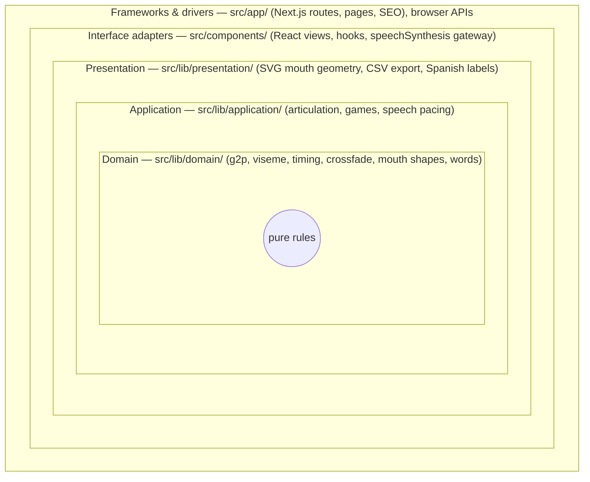
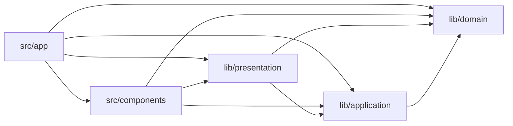

# Architecture

> **Maintenance Invariant:** Update in the SAME commit as any change to the pipeline, module boundaries, or route structure. Terms are defined once, in [glossary.md](glossary.md).
> **Answers:** What does the app do end-to-end, what is the pipeline, where does domain code live?

## What it does

Spanish lipreading trainer delivered as a set of games over one viseme pipeline. An avatar articulates a word; the learner reads the lips. Homophenous sets (`pala` / `bala` / `mala`) are the difficulty, generated on purpose.

The MVP is a single forced-choice game — see [games.md](games.md). It exists to evaluate the model before more games are built: if the render is not legible, no game built on it is worth writing.

## Hard product constraints

- Audience is Spain. Peninsular pronunciation is the default everywhere, dialect settings included. See [g2p.md](g2p.md).

- Browser only. Vector face drawn in code around a parametric mouth. No 3D, no photographic frames — both were tried and dropped. See [avatar.md](avatar.md).
- Text→viseme core runs fully offline: no network call, no server inference, no lexicon or model download. Affordable because Spanish G2P is rule-complete — see [g2p.md](g2p.md).
- Audio may go online in the MVP: spoken word out, spoken answer in, both via Web Speech. Decided — see the audio section of [games.md](games.md).
- Keep the offline core offline regardless. Audio going online is not a licence to move G2P, viseme mapping, or game rules off-device.

## Pipeline

1. Normalize — casing, punctuation, accents preserved. OPEN: numbers and abbreviations.
2. G2P — text → IPA phonemes, syllabified and stressed. Specified in [g2p.md](g2p.md).
3. Phrase pass — sinalefa and cross-word linking over the phoneme stream. OPEN.
4. Viseme mapping — phonemes → viseme codes, many-to-one. Specified in [visemes.md](visemes.md), implemented in `src/lib/domain/viseme/`.
5. Timing — per-viseme durations, stress-weighted, merged and framed by rest. Specified in [timing.md](timing.md), implemented in `src/lib/domain/timing/`. `toWordSpans` derives per-word start/end times from the same segments, for anything that needs word-level sync instead of viseme-level.
6. Render — each entry's sound selects a parameter set, blended across boundaries for coarticulation. Shape model in `src/lib/domain/mouth/`, blend weights in `src/lib/domain/crossfade/`, SVG geometry in `src/lib/presentation/mouth/`, painting in `src/components/`. `src/lib/application/articulation/` runs stages 2–6 for one text. See [avatar.md](avatar.md).

Two consumers hang off stage 4, not off the renderer: distractor generation groups words by viseme sequence, and `PROGRESO` scores accuracy per viseme class. See [games.md](games.md).

Audio playback and speech input sit beside this pipeline, not inside it. They take the word, not the phoneme stream. Playback is built and specified in [voice.md](voice.md) — it reads stage 5's timeline only to know how long it has to speak. Speech input is still OPEN.

Stages 2, 4 and 5 are specified and built. Fill in each section here as its stage lands; do not let this page drift into an index of unrelated facts.

## Current state

Stages 2, 4, 5 and 6 are implemented and tested in `src/lib/domain/g2p/`, `src/lib/domain/viseme/`, `src/lib/domain/timing/`, `src/lib/domain/crossfade/` and `src/lib/domain/mouth/` — text in, timed viseme clip out, drawn as an interpolated mouth inside a vector face. Stages 1 and 3 are unbuilt and the parameter values are untuned. `/debug` renders the library end to end.

The product shell and all four screens are built — see [ui.md](ui.md). `JUEGOS` is a catalogue portal of five built games: ¡Adivina la palabra! (`/juegos/adivina-la-palabra`, on an agent-drafted, not yet native-speaker-reviewed word bank) and four sentence games over speech-therapist-authored sets — Frases por sílaba, ¿Qué frase dijo?, Ordena la frase, Construye la frase — see [games.md](games.md). `INICIO` is a marketing/intro screen with a static avatar and greeting (see SEO below); `PROGRESO` and `MI PERFIL` are still blank placeholders. Speech output is built and wired — `src/lib/application/speech/` and `src/components/voice.ts`, live on `/debug` and in every game (voice on by default, `DIFICULTAD` gates it off at Difícil, mute on the `Player` icon via `useMuted`); INICIO stays silent. See [voice.md](voice.md). `SpeechRecognition` is decided and unbuilt; the mic pill is inert.

## App shell

- `/debug` — the library tester: text in, IPA, viseme timeline, the drawn mouth and the live blend weights out. Controls: dialect, speed, transition, exaggeration, inter-word pause, and the voice (on/off, gender, which system voice, volume). Its voice panel reports what the voice measured — rate, target, spoken duration, drift, pace, overhead, launch latency — and reports only: there is no calibration knob, because nothing about a voice is configured by hand. See [voice.md](voice.md). Transport: play, pause, resume, and seek by clicking a block of the timeline. Timeline blocks name the sound and its viseme. Carries the alphabet panel (each letter's sounds drawn as mouths; a click holds that shape on the face) and the per-sound shape tuner, whose edits drive playback and copy out as CSV. Permanent. It inspects the pipeline independently of the product's rendering, so it stays useful after the real player lands.
- `/debug` re-renders on every animation frame, so its heavy panels (`Stage`, `Tuner`, `Alphabet`) are memoized and the tuner's callbacks are stable. Without that the frame cost makes the mouth itself look late.
- Every `/debug` knob lives in one `DebugSettings` object (`src/app/debug/settings.ts`), never as scattered state. The copy button in the Ajustes header writes the whole set, plus the chosen voice and the last measurement, to the clipboard as plain text — that is how a tuning session is handed over. Add a knob there and it is copied for free. The shape tuner carries the same button over its CSV (`src/app/debug/copy-button.tsx` is the one implementation). Neither panel prints its output on the page. Both copies open with an instruction line (`src/app/debug/prompts.ts`) naming the constants the values belong in, so a pasted tuning session needs no further explanation.
- `/debug` copy is in Spanish, hardcoded — it is reviewed with a speech therapist. Code, file and function names stay as written. No i18n framework; the product's own screens decide their own approach later.
- `/debug` is dev-only. A production build (static export) renders 404 for it; `pnpm dev` serves it on any host, so phone-on-LAN testing still works.
- Product screens live under the `src/app/(product)/` route group, wrapped by `src/app/(product)/layout.tsx` (sidebar plus the `AJUSTES` pill). The group is URL-transparent; `/debug` sits outside it and never inherits the shell. Anatomy, routes and theme in [ui.md](ui.md).
- `INICIO` (`/`) — marketing entry point: headline, benefits, a static avatar with a fixed "Hola, bienvenido" bubble (`src/app/(product)/welcome-player.tsx`, a server component — no player, no motion), and a link into `JUEGOS`. Carries the site's SEO copy and JSON-LD.
- `FORMAS DE LA BOCA` (`/formas-de-la-boca`) — public, indexed reference: the full alphabet, each letter with the mouth of each of its sounds, built on the shared `AlphabetChart`. Server component, own SEO `metadata` + `LearningResource` JSON-LD. See [ui.md](ui.md).
- `JUEGOS` (`/juegos`) — catalogue portal over `GAMES`; each game plays at `/juegos/<slug>` (`[slug]` route, `dynamicParams = false`, statically generated per game). Game metadata is data, not per-route code — see [games.md](games.md).
- `PROGRESO` (`/progreso`) — history and per-viseme accuracy, aggregated across games. Blank placeholder. OPEN: metrics.
- `MI PERFIL` (`/perfil`) — learner identity, persisted locally. Blank placeholder. OPEN: what is stored.
- `AJUSTES` — dialect, avatar, accessibility. Global settings only; per-round settings belong to the game. Deactivated pill (`disabled`), opens nothing yet.

## SEO

- Target queries: "logopeda online", "ejercicios de logopedia" / "ejercicios logopeda", "logopeda infantil", plus the lipreading/hearing-loss cluster (lectura labial, pérdida auditiva, hipoacusia).
- `src/app/layout.tsx` — site-wide `metadata` (title template, description, keywords, OpenGraph, Twitter `summary_large_image`, `applicationName`, `creator`/`publisher`, `category`, `formatDetection`, `alternates.languages`, `robots.googleBot`) and `viewport`. `<html lang="es">` — the product is Spanish-only, fix this if that ever changes. It also mounts `<VoiceWarmup />` (renders nothing; see [voice.md](voice.md)) and emits the site-wide `@graph` JSON-LD: `Organization` (founder Julio César Martín) + `WebSite`.
- `metadataBase` and the URLs in `robots.ts`/`sitemap.ts` read `NEXT_PUBLIC_SITE_URL`, falling back to the production origin `https://vilabia.es`. Override the env var only for non-prod deploys; it is inlined at build time.
- `src/app/robots.ts`, `src/app/sitemap.ts` — Next.js file-convention routes. `robots.ts` also sets `host`. Sitemap lists `/`, `/formas-de-la-boca`, `/juegos` and every `/juegos/<slug>` derived from `GAMES`, each with `lastModified`; `/progreso` and `/perfil` are blank placeholders and carry `robots: { index: false }` in their own page metadata instead. `/debug` is disallowed in `robots.ts` and also `noindex, nofollow` in its own metadata, on top of the production 404.
- `src/app/manifest.ts` — web app manifest (name, theme/background from the palette, `es-ES`, education/health categories, icon `/icon.svg`).
- `src/app/icon.svg` — the favicon: the logo `Mark` alone (see [ui.md](ui.md)). Replaces the old `favicon.ico`. Kept in sync with `src/components/wordmark.tsx` by hand.
- `src/app/opengraph-image.tsx` — 1200×630 OG/Twitter image generated at build with `next/og` `ImageResponse`, inherited by every route. No external font.
- `/` and `/juegos` set their own static `metadata` in `page.tsx`; `/` adds its own `keywords`. Each `/juegos/<slug>` builds its `metadata` in `generateMetadata` from that game's `seo` block in `GAMES` — title, description and canonical are never hardcoded per route. `/` also emits `WebApplication` + `FAQPage` JSON-LD (one array), the `FAQPage` mirroring the on-page "Preguntas frecuentes" `
` list.

## Layers

Clean Architecture's dependency rule, kept simple: five rings, and imports only point inward. The names matter less than the direction.

- `src/lib/domain/` — what is true of Spanish speech and mouths, whatever screen shows it. `g2p` (spelling → phonemes), `viseme` (inventory, alphabet, distance), `timing` (durations → timeline), `crossfade` (blend weights across a boundary), `mouth` (shape table, `shapeAt`), `words` (the word bank), `phrases` (the authored sentence sets).
- `src/lib/application/` — what the product does with the domain. `articulation` (text → `Clip`, `frameAt`, `voiceFits`, `voiceCues`), `games` (catalogue and per-game rules), `speech` (voice pacing and choice).
- `src/lib/presentation/` — domain data turned into something a screen can draw or a person can read. `mouth` (`toGeometry` SVG paths, `toCsv`), `labels` (Spanish viseme names and descriptions).
- `src/components/` — React: views, hooks that wire the application to time and the browser (`useArticulation`, `usePlayback`, `useVoice`), and the only `window.speechSynthesis` access (`voice.ts`).
- `src/app/` — Next.js routes and anything used by one route only.
- Enforced by `no-restricted-imports` in `eslint.config.mjs`: `pnpm lint` fails on an outward import. `src/lib/` also never imports React or Next, and never climbs out of its layer with `../`.
- Decide where new code goes by asking what it would still mean without this UI: a Spanish-speech fact → domain; a product behaviour → application; a way of drawing or wording → presentation; React or browser → components.
- A hook holds state and timers only. Anything computable from its inputs is a pure function in `lib/application/` and is tested there.

## Module boundary

- `src/app/` — routes and route-specific UI. Never holds pipeline logic.
- `src/components/` — UI shared between routes: the mouth art, the mouth on its own, the face that nests it, `alphabet-chart.tsx` (every letter's mouths; static on `/formas-de-la-boca`, clickable on `/debug`), the sidebar/wordmark/icons, `player.tsx` (the one click-to-play/pause stage shell), `tip.tsx` (a `--color-panel` hint card with a "Consejo:" label), and the `useArticulation`/`usePlayback`/`useVoice` hooks. `/debug` and each game stage render the same `Player` around their own children; `INICIO` renders a bare static `Face` with no `Player` — see [ui.md](ui.md)'s Player section.
- Game rules are application code, not UI: one `lib/application/games/<game>/` per game, with `src/app/` rendering it. Keeps a second game from forking the first game's screens. Built: `lib/application/games/adivina/` (round draw, level curve, round/answer state) and `lib/application/games/frases/` (the sentence games' rules). Screens share one round shell, `src/app/(product)/juegos/shared/` (`round-player.tsx`, `word-card.tsx`, `settings-panel.tsx`, `sentence-game.tsx`, `word-order-game.tsx`).
